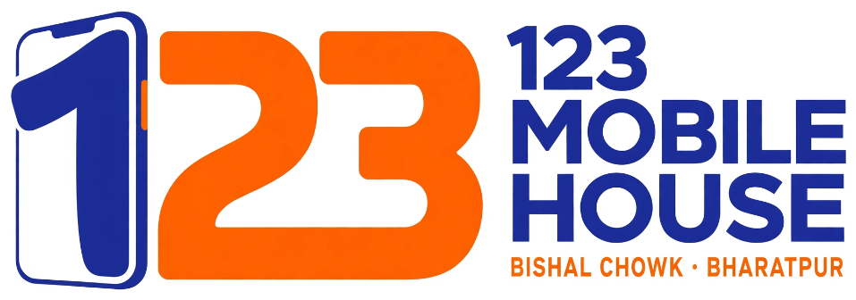

# 123 Mobile House — Official Website

Official website and digital catalog for **123 Mobile House**, located at Bishal Chowk, Bharatpur, Chitwan, Nepal.

## Overview
123 Mobile House is a premier smartphone showroom, accessories store, and express repair center in Bharatpur, Chitwan. This website provides real-time stock checks, today's rate confirmation via WhatsApp, an interactive repair cost estimator, and detailed showroom directions.

## Pages & Features
- **[Home (`index.html`)](index.html)**: Clean, high-impact hero, 2-column interactive brand showroom (Samsung, Apple, Xiaomi, Vivo, Oppo, Realme, Infinix), 3-step buying guide, counter diagnostic estimator, and customer FAQ.
- **[Phones Catalog (`phones.html`)](phones.html)**: Comprehensive smartphone catalog with instant live search and one-click WhatsApp price inquiry for all models.
- **[Accessories & Audio (`accessories.html`)](accessories.html)**: Covers, 9H tempered screen protection, fast GaN chargers, audio earbuds, and phone model compatibility checker.
- **[Services & Repair (`services.html`)](services.html)**: Express on-site repairs (display, battery swap, charging port) with instant WhatsApp estimate docket.
- **[About Us (`about.html`)](about.html)**: Showroom story, warranty assurance (100% NTA approved & official VAT bill), and customer trust pillars.
- **[Contact & Visit (`contact.html`)](contact.html)**: Interactive WhatsApp inquiry desk, embedded Google Maps, landmark travel routes, and store opening hours.

## Key Design & Tech Highlights
- **100% Responsive**: Tailored for mobile devices (360px–480px), tablets, and widescreen desktop displays.
- **Zero Viewport Overflow**: Viewport-safe styling and fluid layout.
- **Official Brand Identity**: Official royal blue & orange brand logo in navigation, splash preloader, and footer.
- **Preloader**: 0.5-second app-style splash animation with custom progress bar.
- **Floating Controls**: Floating WhatsApp trigger with interactive message modal + smooth Back to Top button.
- **Vector Graphics**: Pure SVG icons throughout the UI.

## Store Information
- **Location**: Bishal Chowk, Bharatpur, Chitwan, Nepal
- **Opening Hours**: Open Every Day (Sunday – Saturday) &bull; 9:00 AM – 8:00 PM
- **Direct Helpline / WhatsApp**: +977 9844338306

---
*Website designed & developed by **Rajan Sharma**, Website Developer.*
